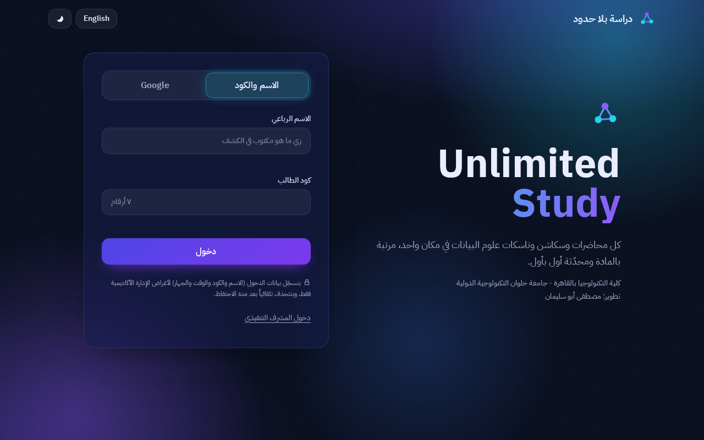

# Unlimited Study — دراسة بلا حدود

Study platform for Data Science students at Cairo Technology College, Helwan International Technological University.
Built by **Mostafa Apo Soliman** (Executive Supervisor).

Arabic-first (RTL) with an English toggle, dark/light themes, 8 subject hubs (lectures · sections · tasks · materials), two student sign-in paths, and a live supervisor dashboard.



## Features
- **Sign-in path A — Google**: server-verified ID token; first time the Gmail account is linked to the roster once (name + code).
- **Sign-in path B — four-part name + student code**, checked against the **384-student roster** extracted from the official PDF (Arabic-normalised: hamza, ى/ي, ة/ه, harakat, tatweel and "عبد الرحمن/عبدالرحمن" spacing are tolerated).
- **Executive Supervisor panel** (separate login, optional TOTP 2FA): live online count, sign-ins today/week, % of roster that ever signed in, failed-attempt spike alert, charts (per day, per hour in Cairo time, per hall, per subject, top downloads), filterable/paginated activity table with live rows (Server-Sent Events) and CSV export, roster management (deactivate, unlink Google), and content management (lectures, sections, tasks, announcements, multi-file drag-and-drop upload with progress, edit subject/doctor/TA).
- Students see "new" badges for content added since their last visit.
- Subjects without sections/tasks (History of Technology, Health and Safety) automatically hide those tabs.

## Quick start
Requires **Node.js 22+** (`better-sqlite3` 13 and `google-auth-library` 11 do not support older versions) and, only if you want to re-extract the roster, Python 3 with `pdfplumber`.

```bash
npm ci
cp .env.example .env        # then fill SESSION_SECRET, ADMIN_EMAIL, ADMIN_PASSWORD (>=10 chars); optional GOOGLE_CLIENT_ID. Blank KEY= lines are treated as unset
npm run seed                # creates storage/study.db: 384 students, 8 subjects, the admin (idempotent)
npm start                   # http://localhost:3000
```
`better-sqlite3` and `argon2` ship prebuilt binaries; if your server cannot download them, install a C++ toolchain (`build-essential`, `python3`) so `npm ci` can compile them.

`client/dist` is pre-built. To rebuild after editing `client/`: `npm run build` (dev dependencies needed, i.e. `npm ci` without `--omit=dev`).

Sign in as admin at the login page → "دخول المشرف التنفيذي".

### Google Sign-In setup
1. Google Cloud Console → APIs & Services → Credentials → *Create OAuth client ID* → Web application.
2. Authorised JavaScript origins: your site origin (e.g. `https://study.example.edu`, and `http://localhost:3000` for dev).
3. Put the client ID in `GOOGLE_CLIENT_ID` and restart. Without it the Google tab shows a clear "not enabled" message.

### Deployment (single VPS)
- Run behind a TLS-terminating proxy (Caddy/nginx); set `TRUST_PROXY=1`. Cookies are `Secure` in production, so HTTPS is required.
- Keep it alive with systemd or pm2 (`node server/index.js`).
- **Back up `STORAGE_DIR`** (SQLite DB + uploads) daily.
- `Dockerfile` / `docker-compose.yml` are provided but **were not tested** (no Docker in the authoring environment).

## Scripts
| Command | What it does |
|---|---|
| `npm start` / `npm run dev` | run the server |
| `npm run seed` | idempotent seed (students from `data/students.csv`, subjects, admin) |
| `npm run build` | Tailwind CLI + copies self-hosted fonts/GSAP/Chart.js into `client/dist` |
| `npm test` | 50 tests (Arabic normalisation, roster data, auth, authz, uploads, CSRF, rate limits, logs, exports, config, Cairo-day filters, regressions) |
| `npm run extract -- <pdf>` | re-extract the roster to `data/students.csv` + `data/roster-report.md` |
| `npm run screenshots -- dark\|light\|misc` | real-browser run that regenerates `docs/screenshots` and the a11y report (`merge` combines phases) |

## Layout
```
server/   config.js  db.js (schema+migrations)  repo.js (ALL SQL)  middleware.js  app.js  seed.js  routes/{auth,student,admin}.js  lib/
client/   public/index.html  src/styles.css (tokens)  js/{main,core,i18n,views,admin}.js  dist/ (built)
data/     students.csv  roster-report.md
scripts/  extract-roster.py  spotcheck.py  seed.js  build-client.js  screenshots.js
tests/    *.test.mjs (vitest + supertest)
docs/     screenshots/  ui-verification.json  contrast-report.md
```
More: `README_MOSTAFA_APO_SOLIMAN.md` (developer guide, Arabic), `SECURITY.md`.

## Decisions you should know about
- **SQLite instead of PostgreSQL.** One file, zero ops, fine for ~400 students. All SQL is in `server/repo.js` and migrations in `server/db.js`, so moving to Postgres means reimplementing those two files.
- **Plain JS SPA, no framework/bundler.** ES modules served as-is; keeps the strict CSP simple and the build to one Tailwind command.
- **The roster PDF says "الفرقة الأولى" (first year)** while the original brief said second year. The label is configurable via `COHORT_LABEL`.
- **The 8th subject is a placeholder** ("المادة الثامنة — قريباً"). Rename it from the admin panel (Content → Edit subject) when the real subject is known.
- Dr. Sherif teaches three subjects; Web Applications has no TA listed (shown as "غير محدد"); Health and Safety has no named doctor.

## Verification status (what was actually run)
- Unit/integration: **50/50 tests pass**; `npm audit`: 0 vulnerabilities.
- Roster: 808 rows scanned (the PDF contains the sheet twice) → **384 unique codes**, 0 conflicts, 0 inversion artefacts; 30-row OCR spot-check 93 % token agreement, the two low rows eyeballed and correct (see `data/roster-report.md`).
- Browser (headless Chromium): 21 audited page states (axe-core run at 360 px and 1280 px, dark and light, Arabic; plus one English page — `docs/ui-verification.json`); screenshots are also taken at 768 px and 1920 px but those two widths were **not** axe-audited → **0 axe-core violations, 0 console/CSP errors, 0 horizontal overflow**; contrast ratios in `docs/contrast-report.md`; live SSE row verified; `prefers-reduced-motion` verified (infinite animations 0, aurora animation off).
- **Not done:** Lighthouse scores (axe-core was used instead), real Google popup flow (needs your client ID), Docker, a real-device test, load testing, penetration testing.
